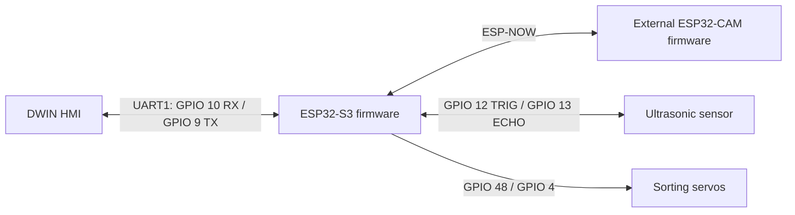

# Embotics Reverse Vending Machine Firmware

PlatformIO firmware for an ESP32-S3-based reverse vending machine prototype. The checked-in implementation integrates a DWIN HMI over UART, an ultrasonic inlet sensor, two sorting servos, and an ESP-NOW interface to a separately provisioned ESP32-CAM.

## Current implementation

- One PlatformIO build environment: `esp32-s3-devkitc-1` with Arduino.
- Bottle classification results are received from the camera controller and majority-voted over three predictions.
- A confirmed green or white bottle moves a corresponding servo and adds Rs 10 to an in-memory transaction.
- The firmware writes a string of the form `RVM|amount|transactionID` to a DWIN VP. No payment transfer or backend validation is implemented here.

The repository does not currently include the ESP32-CAM firmware/model, DWIN UI project, schematics, or hardware test records. See [the audit](docs/PROJECT_AUDIT.md) for what is and is not evidenced.

## Architecture



Editable diagram: [system block diagram](docs/diagrams/system_block_diagram.mmd).

## Build and setup

Install PlatformIO Core and the ESP32 platform, connect the target board, then run:

```powershell
pio run -e esp32-s3-devkitc-1
pio run -e esp32-s3-devkitc-1 -t upload
pio device monitor -b 115200
```

The checked-in configuration is [platformio.ini](platformio.ini). This workstation's attempted build did not reach compilation; see [build and validation notes](docs/TESTING_AND_VALIDATION.md). Hardware setup cannot be reproduced from the source alone; check the pinout and electrical unknowns before wiring.

## Documentation

- [Project audit](docs/PROJECT_AUDIT.md)
- [Complete firmware guide](docs/COMPLETE_FIRMWARE_GUIDE.md)
- [DWIN HMI](components/hmi_dwin/README.md) | [ESP32-CAM interface](components/esp32cam_vision/README.md)
- [Hardware integration](components/hardware_integration/README.md) | [Motor control](components/motor_control/README.md)
- [QR / rewards](components/payment_rewards/README.md) | [Barcode / QR](components/barcode_qr/README.md)
- [All docs and diagrams](docs/README.md)

## Verification and limitations

The code has not been hardware-verified in this task. There are no checked-in automated tests. The PlatformIO build attempt failed at package resolution with `MissingPackageManifestError`, before source compilation. Classification, HMI UI rendering, ESP-NOW interoperability, servo mechanics, electrical safety, and any payment outcome therefore remain unverified.

## Contributions

Author and collaborator credits are not established by the available project files. Add verified contribution details in [CONTRIBUTIONS_AND_CREDITS.md](docs/CONTRIBUTIONS_AND_CREDITS.md) before publishing this repository as a portfolio project.
