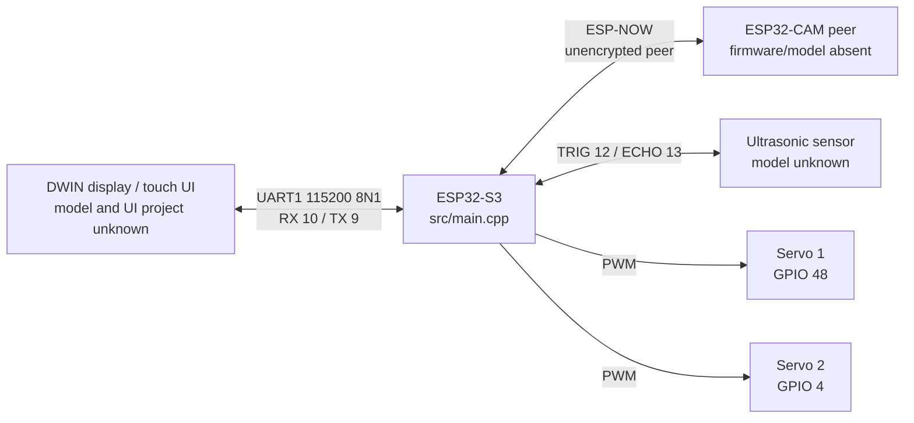

# System Architecture

The peripherals are identified by source symbols and APIs only; no manufacturer/model or electrical rating is established. The optional `RVMHardware` class describes additional conveyor, crusher, second ultrasonic and IR interfaces but is not instantiated by the integrated application. No power distribution diagram or independent safety controller is included.

See [hardware architecture](HARDWARE_ARCHITECTURE.md), [communication protocols](COMMUNICATION_PROTOCOLS.md), and [editable diagrams](diagrams/).
